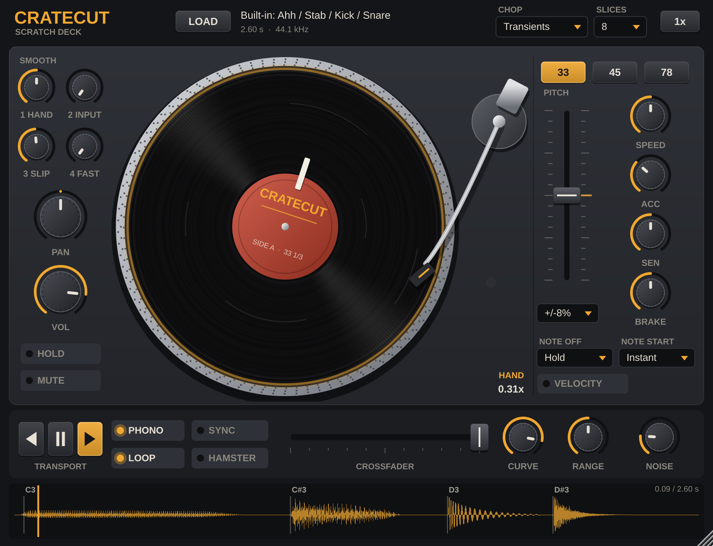

# CrateCut — scratch deck instrument (VST3 / AU)

A turntable you can play from a DAW. Load a sample (a vocal phrase, a horn stab,
a break) and it gets "pressed" to a virtual record. You can scratch it with the
mouse, a MIDI controller or host automation, cut it with a scratch-mixer
crossfader, and chop it across the keyboard. It's built for boom bap: DJ
Premiere-style cut-up hooks, chopped vocal phrases and transformer cuts in the
gaps of a beat.



## Why it sounds like a deck and not a pitch-bend

The deck is a physical model, not a playback-rate knob:

| Part | What's modelled |
|---|---|
| **Motor** | Direct-drive torque: the platter takes ~0.7 s to reach 33 rpm and brakes over ~1 s (ACC and BRAKE). It plays forwards or backwards. |
| **Slipmat** | Coulomb friction. When you let go, the spinning platter drags the record back up to speed in a linear ramp (~45 ms). That's the classic "release" sound. |
| **Hand** | A critically damped spring between your hand and the record. Grabbing a spinning record stops it dead without springing back. Automation and MIDI steps are smoothed into continuous motion, so there's no zipper noise. |
| **Groove** | The sample is RIAA pre-emphasised at load ("cut to vinyl"). Surface noise and crackle are pressed into the groove too, so they scratch back and forth with the record. |
| **Cartridge + phono stage** | Output follows stylus *velocity*, then fixed RIAA de-emphasis. Slow drags fade towards silence, fast pushes hit harder than the source, and the polarity flips on the back-stroke, just like a real cartridge. At exactly 1× it's transparent (tested to −43 dB residual). |
| **Needle** | A band-limited sinc reader with a kernel that widens with speed. Fast flicks don't alias and slow groans don't buzz. Works both directions. |
| **Crossfader** | Scratch-mixer cut curve with a small cut-lag, adjustable from smooth to razor, plus hamster reverse. Click-free cuts. |

## Coming from Fruity Scratcher

Every Fruity Scratcher control has an equivalent here. Image-Line doesn't
document what each of its four SMOOTH knobs does internally, so CrateCut
defines its own four, each with one clear job:

| Fruity Scratcher | CrateCut | What it does here |
|---|---|---|
| SMOOTH 1 | **1 HAND** | The give between hand and record. Low is tight and twitchy, high gives soft, rounded strokes. |
| SMOOTH 2 | **2 INPUT** | Glides between control points (mouse moves, MIDI steps, automation). Raise it for a coarse mouse or 7-bit CC; keep it near 0 for a high-resolution mouse or pen tablet. |
| SMOOTH 3 | **3 SLIP** | Slipmat grip: how fast the platter pulls the record back up to speed when you let go. |
| SMOOTH 4 | **4 FAST** | Softens the top end of very fast movements, taking the fizz off hard flicks. |
| PAN / VOL | **PAN / VOL** | Balance and level. |
| HOLD | **HOLD** | Holds the record still. Turn it on when a controller drives the platter: the linked *Scratch* parameter then moves the record directly, with no *Touch* needed. |
| MUTE | **MUTE** | Click-free mute, handy for automation. |
| SPEED | **SPEED** | Playback speed (1× = normal). Stacks with 33/45/78 and the pitch fader. |
| ACC | **ACC** | How quickly the motor gets the platter up to speed. |
| SEN | **SEN** | How far the record moves for a given mouse, jog wheel, pitch-bend or CC movement. |
| ◀ ❚❚ ▶ | **TRANSPORT** | Play backwards, pause (the platter brakes to a stop), play forwards. |
| Right-click platter → Link to controller | **Right-click the platter** | Opens FL's menu for the *Scratch* parameter, so you can link a controller or create an automation clip. Turn on HOLD when you do. Every knob and fader has the same right-click menu. |
| Waveform / folder / 2x | **Waveform / LOAD / 1x-2x** | Click the waveform to drop the needle, load by button or drag-and-drop, and zoom the window. |

## Ways to scratch

All of these can be used at the same time.

1. **Mouse.** Grab the record and drag it around. Release to let the slipmat take it.
   A trackpad two-finger swipe over the record works like a jog wheel.
2. **Automation.** The *Touch* (hand on record) and *Scratch* (hand position)
   parameters are fully automatable, and so is the *Crossfader*. Mouse scratching
   writes into those parameters with proper gestures, so you can **record a
   performance as automation**, then edit it.
3. **MIDI** (all mappings are configurable in the plugin's parameter list):

| Input | Default | Does |
|---|---|---|
| Pitch bend | on | Scratch. Off-centre grabs the record, centre lets go. A spring-loaded wheel gives a baby scratch for free. |
| CC 64 (sustain pedal) | Touch CC | Hand on the record while held. |
| CC 1 (mod wheel) | Scratch CC | Hand position. It grabs automatically while it moves. |
| CC 16 | Jog CC | Relative jog wheel / endless encoder (Offset-64, two's-complement or sign-bit; ticks per revolution adjustable). |
| CC 11 (expression) | Fader CC | Crossfader. |
| MIDI 48 | Touch Note | Hold to keep your hand on the record. |
| MIDI 50 | Cut Note | Hold to close the fader. Tap it for transformers and chirps. |
| MIDI 60 and up | First Chop Note | Each key drops the needle on a chop and lets it play. |

> **Note names:** FL Studio calls MIDI note 60 **C5**. Most other DAWs call it C3 or C4.
> In FL the defaults are: Touch = C4 (48), Cut = D4 (50), chops start at C5 (60).

### Chops

*Chop Mode* = **Transients** places the chops on the strongest detected hits
(sorted by time). **Even** slices the sample into equal parts. *Slices* sets how
many keys are used; notes past the last chop wrap around. The waveform strip
shows each chop with its key. Click or drag on the waveform to drop the needle
anywhere.

*Note Off* sets what releasing a chop key does:
**Hold** keeps playing, **Cut** closes the fader (tight MPC-style chops),
**Hand Stop** stops the record by hand, and **Brake** gives a power-off slowdown.
*Note Start* = **Release** holds the record at the cue and lets go, so you hear
the slipmat pull it up to speed.

## Using it in FL Studio (macOS)

1. Install the plugin (see below), then in FL: **Options → Manage plugins → Find
   installed plugins**. CrateCut appears under *Generators*.
2. Add it to the Channel Rack and drag a sample onto the plugin window.
3. **Recording a scratch:** turn on Record (with *Automation* enabled in the
   recording filter), press play and scratch the record with the mouse. FL
   records *Touch* and *Scratch* (and the crossfader if you move it) as
   automation, which you can then tidy up in automation clips.
4. **Hardware control:** if FL doesn't pass a controller's CC or pitch bend
   through to the plugin, right-click a parameter in the plugin wrapper and use
   **Link to controller**. *Touch*, *Scratch* and *Crossfader* are normal
   automatable parameters, so any knob, fader or wheel can drive them.
5. **Repeatable renders:** turn on **SYNC**. The motor then follows FL's
   transport, and every press of play resets the needle to the start of the
   record. Automation then renders identically every time. Use notes to drop
   the needle where you want each scratch to start.

### A Premiere-style hook in four steps

1. Load a short vocal phrase and set *Chop Mode* to Transients so each word gets a key.
2. In the piano roll, put the word you want to cut on the beat's gaps (for
   example the "2-and" and "4-and").
3. Automate *Touch* on just after each note and draw a quick forward/back
   *Scratch* shape. Short and tight sounds like a chirp; longer sounds like a drag.
4. Put the Cut Note (MIDI 50) under the scratch strokes for transformer cuts. You
   can also draw the crossfader and keep *Curve* near max for a hard cut.

## Installing (macOS)

Pre-built universal (Apple Silicon + Intel) binaries come from GitHub Actions.
Open the repo's **Actions** tab, open the latest *Build* run and download the
**CrateCut-macOS** artifact. Unzip it until you have a `CrateCut` folder, then:

1. Double-click **Install CrateCut.command**.
2. **First time only:** macOS blocks it because it isn't notarised by Apple.
   Click *Done*, open **System Settings → Privacy & Security**, scroll down
   and click **Open Anyway** next to "Install CrateCut.command".
3. A Terminal window installs everything and says when it's done. You don't
   need to type anything.

The installer copies the VST3, the Audio Unit and the standalone app into
your user folders (`~/Library/Audio/Plug-Ins/…` and `~/Applications`). It
clears the download quarantine, re-signs the plugins locally and refreshes the
Audio Unit cache. No admin password is needed. Then restart FL Studio and run
**Options → Manage plugins → Find installed plugins**.

The one-time "Open Anyway" step only goes away if the build is signed and
notarised with a paid Apple Developer ID.

Pushing a tag like `v0.1.0` also attaches `CrateCut-mac.zip` to a GitHub Release.

## Building from source

Requirements: CMake ≥ 3.22 and Xcode command-line tools. JUCE 8 is fetched
automatically.

```bash
cmake -B build -DCMAKE_BUILD_TYPE=Release
cmake --build build --config Release --target CrateCut_VST3 CrateCut_AU CrateCut_Standalone
```

The built plugins are in `build/CrateCut_artefacts/Release/`. Pass
`-DJUCE_DIR=/path/to/JUCE` to use a local JUCE checkout.

### Tests

An offline harness drives the real processor through scratch scenarios and
checks the physics and audio numerically. It covers grab/hold/release, motor
torque and brake, click-free fader cuts and needle jumps, MIDI pitch-bend and
jog scratching, bit-identical host-synced renders, state save/restore with the
embedded sample, and CPU load. It also writes WAVs you can listen to and a UI
snapshot.

```bash
cmake -B build -DCRATECUT_BUILD_TESTS=ON -DCMAKE_BUILD_TYPE=Release
cmake --build build --target CrateCutTests
./build/CrateCutTests_artefacts/Release/CrateCutTests test-output
```

## Sessions and samples

The sample's path is saved with the project. Samples up to 90 s are also
embedded in the project as FLAC, so the project still opens if the file is
moved or the project goes to another machine.

## Layout

```
Source/
  PluginProcessor.*     host glue, state, lock-free sample hand-off
  PluginEditor.*        UI layout (scalable 1x / 1.5x / 2x, resizable)
  Parameters.*          parameter definitions
  dsp/TurntableEngine.* motor, slipmat, hand, needle, phono stage, fader, MIDI
  dsp/SincReader.h      band-limited bidirectional variable-rate reader
  dsp/Riaa.h            RIAA cut/playback curves, filters
  dsp/RecordData.*      pressing a sample: groove, surface noise, overview, transients
  dsp/DefaultSample.*   synthesised built-in record (ahh / stab / kick / snare)
  ui/                   platter, waveform, look-and-feel
tests/OfflineTests.cpp  offline render + physics tests
```
